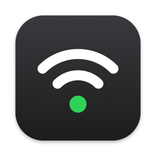
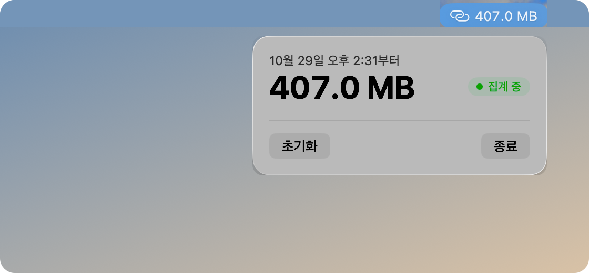

  

<h1 align="center">Hotspot Meter</h1>

정해진 시간 동안 핫스팟으로 쓴 데이터를 메뉴바에서 바로 확인하는 macOS 앱

  

## 이런 때 쓰면 좋습니다

- 외부 인터넷을 쓸 수 없는 강의, 행사, 출장지에서 휴대폰 핫스팟으로 며칠 버텨야 할 때
- 요금제나 데이터 쿠폰처럼 쓸 수 있는 양이 정해져 있어서, 지금까지 얼마나 썼는지 확인하며 아껴 써야 할 때
- 특정 작업이나 기간 동안 핫스팟 데이터가 얼마나 드는지 재 보고 싶을 때

## 설치

1. [Releases](https://github.com/toy-crane/hotspot-meter/releases/latest)에서 최신 `HotspotMeter-버전.dmg`를 내려받습니다.
2. DMG를 열고 Hotspot Meter를 Applications 폴더로 끌어다 놓습니다.
3. 응용 프로그램 폴더나 Spotlight에서 Hotspot Meter를 실행합니다.

macOS 15 이상에서 동작합니다. Apple의 공증을 받은 앱이라 보안 경고 없이 열립니다.

## 사용법

1. 측정을 시작하고 싶은 순간에 메뉴바의 Hotspot Meter를 눌러 창을 열고 **초기화**를 누릅니다.
2. 그때부터 핫스팟으로 쓴 데이터가 쌓이고, 메뉴바에 누적 사용량이 계속 표시됩니다.
3. 창 맨 위에 언제부터 센 값인지(예: `10월 29일 오후 2:31부터`)가 나옵니다.
4. 다음 측정을 시작할 때 다시 **초기화**를 누릅니다. 실수로 지우지 않도록 확인 창이 한 번 더 뜹니다.

창 오른쪽의 표시로 지금 집계 중인지 알 수 있습니다.

| 표시 | 뜻 |
|---|---|
| ● 집계 중 | 핫스팟에 연결되어 있고, 쓰는 만큼 누적에 더해집니다. |
| ● 핫스팟 아님 | 일반 Wi-Fi나 유선 네트워크라 집계하지 않습니다. 메뉴바 아이콘도 흐리게 바뀝니다. |

연결이 끊겼다가 다시 연결되거나(USB 케이블을 뺐다 꽂는 경우 포함), 앱이나 Mac을 다시 시작해도 누적은 이어서 쌓입니다.

## 핫스팟을 어떻게 알아보나요

macOS는 iPhone 개인용 핫스팟처럼 데이터 요금이 드는 연결을 따로 표시합니다. Hotspot Meter는 이 표시가 붙은 연결만 골라, 그 연결로 오간 데이터 양을 셉니다. Wi-Fi로 연결한 핫스팟과 USB로 연결한 핫스팟을 모두 알아봅니다.

- 위치 권한이나 다른 시스템 권한을 요구하지 않습니다.
- 사용량은 이 Mac에만 저장되고, 어디로도 보내지 않습니다. 앱 자체가 인터넷에 접속하지 않습니다.

## 알아 둘 점

- **앱이 켜져 있을 때만 집계합니다.** 처음 실행하면 로그인 항목에 등록되어 Mac을 켤 때마다 자동으로 실행됩니다. 자동 실행을 끄려면 시스템 설정 → 일반 → 로그인 항목에서 Hotspot Meter를 끄면 됩니다.
- **통신사 집계와 조금 다를 수 있습니다.** Mac이 주고받은 양만 세기 때문에 iPhone 자체가 쓴 데이터는 포함되지 않고, 통신사마다 계산 방식도 다를 수 있습니다.
- **메뉴바에서 안 보인다면** Hidden Bar나 Bartender 같은 메뉴바 정리 앱이 숨겼을 수 있습니다. `⌘`를 누른 채 Hotspot Meter 아이콘을 항상 보이는 영역으로 옮겨 주세요.
- 용량은 통신사 표기처럼 10진수 단위(1 GB = 10억 바이트)로 보여 줍니다.
